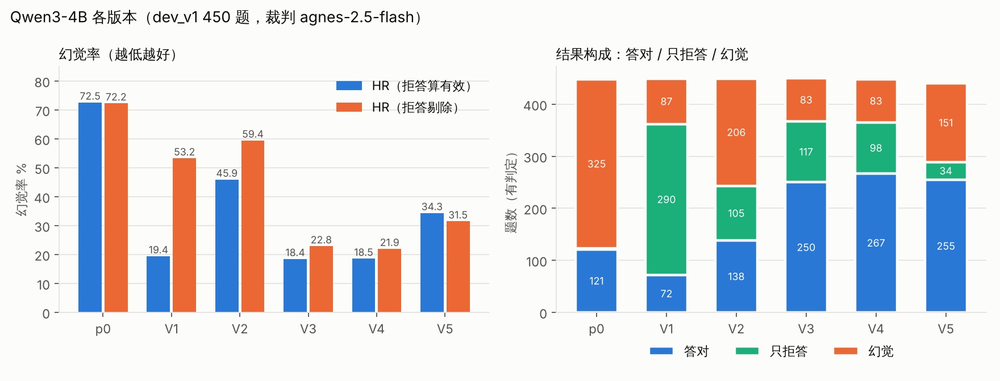

# Chinese LLM Hallucination Evaluation: Prompt Constraints, Retrieval and Abstention Gates on Qwen3-4B / 8B

[中文](README.md) | **English**

> 🖥️ **Showcase page: [`site/index.html`](site/index.html)** (Chinese) — a single static file, no build step; after cloning, just double-click it to open it in a browser. Every number on the page is checked against the script output by `python scripts/check_site_numbers.py`.

On a 450-item Chinese dev set (Chinese SimpleQA + HalluQA), an LLM judge scores the hallucination rate of Qwen3-4B / 8B version by version: starting from answering as-is (p0), each version compares prompt constraints, Wikipedia retrieval, reranking, premise checking, gating and rule-based interception (V1–V7), and the report analyses which changes help and why.

📄 **Full report: [report/Hallucination-Evaluation-Report.md](report/Hallucination-Evaluation-Report.md)** (English) · [中文原版](report/大模型幻觉评测报告.md)

## Key results

Qwen3-4B, dev_v1 450 items, judge agnes-2.5-flash. All numbers are proxy metrics from a local LLM judge (single judge, single sample, dev set), recomputed by script from the stored judgments. "Correct" = answered and not judged hallucinated (the judge does not grade correctness separately); hallucinated and refused overlap slightly (a refusal that also fabricates counts in both).

| Version | Change | Halluc. | Refused | Correct | HR (refusals count as valid) | HR (refusals excluded) |
|---|---|---|---|---|---|---|
| p0 | Answer as-is | 325 | 12 | 121 | 72.5% | 72.2% |
| V1 | System-prompt constraints | 87 | 295 | 72 | 19.4% | 53.2% |
| V2 | Relaxed refusal | 206 | 109 | 138 | 45.9% | 59.4% |
| V3 | + Wikipedia BM25 retrieval | 83 | 126 | 250 | 18.4% | 22.8% |
| **V4** | **+ bge reranking (baseline)** | **83** | **106** | **267** | **18.5%** | **21.9%** |
| V5 | "Check the question for errors first" prompt | 151 | 68 | 255 | 34.3% | 31.5% |
| V6 | Self-judging gate (offline replay) | 64 | 189 | 200 | 14.3% | 22.8% |
| V7 | Keyword-rule interception (offline replay) | 69 | 127 | 260 | 15.4% | 19.0% |

- Retrieval (V3) is the only step between adjacent versions that both reduces hallucinations and increases correct answers, both significantly (paired p<0.001); reranking (V4) leaves hallucinations flat with correct +19 (uncorrected p=0.018, not significant after multiple-comparison correction). Prompting alone only shifts mass between refusals and hallucinations.
- Misleading questions are the weak spot: V5's generic flaw-finding also broke ordinary questions (438 paired items, hallucinations 82 → 151); the V6 gate blocks 19 hallucinations but wrongly refuses 67 correct answers; V7 rules block 14 and wrongly refuse 7.
- On Qwen3-8B (a different judge, not comparable): as-is 67.9% → V4 29.5% → V8 (two narrow question-type hints) 27.1%. V8's gain is concentrated on misleading items, but its hints were written from errors on the same dev set, so it is an in-sample result.
- The retrieval gain is optimistic: the knowledge base is Wikipedia, and 258 of the 300 SimpleQA items cite Wikipedia as their source.



## Reproduce

```bash
pip install -r requirements.txt
python scripts/reproduce_metrics.py
```

```bash
python scripts/make_figures.py
```

The first prints every table number in the report (standard library only); the second redraws the 4 figures in `report/figures/`. Both read only the answers and judgments already in `eval/runs/`; **they call no model or paid API and need no GPU**.

```bash
python scripts/check_site_numbers.py
```

This checks every number on the showcase page against the output of `reproduce_metrics.py`, `judge_agreement.py` and `check_sql.py`, flags any number on the page without a source, checks that the page's local links exist, and checks that every number in the English report, this README and the one-page summary also appears in the Chinese report / README.

## Reproduce in SQL

Load the dev set, answers and per-item judgments into SQLite (standard library only), then recompute the core numbers of report Tables 1–3 in plain SQL — both HR variants, correct counts, refusal rates, per-type results, the V6/V7 offline replays and the V3→V4 paired transition table — and compare them with Python item by item:

```bash
python scripts/build_sqlite.py
```

```bash
python scripts/check_sql.py --print
```

The first creates `sql/hallucination.sqlite` with five tables — `questions`, `runs`, `answers`, `judgments`, `gate_v6` — including version, question type and labels; the file is not committed and can be opened with any SQLite client. The second rebuilds its own copy in a temp directory, runs [`sql/metrics.sql`](sql/metrics.sql), prints each query's result and compares it with the output of `reproduce_metrics.py --json`; currently all 521 items agree. The end of `metrics.sql` has 8 more analytical queries, each with a comment on the question it answers, using window functions (LAG / RANK / NTILE / ROW_NUMBER), CTEs and self-joins. For example:

- Within each question type, is the version with the lowest hallucination rate also the one with the most correct answers?
- Are longer answers more likely to be judged hallucinated?
- Among paired differences between adjacent versions, how many have a word-for-word identical answer where only the judge changed its verdict?

With the sqlite3 CLI installed you can also run: `sqlite3 sql/hallucination.sqlite < sql/metrics.sql`.

## Judge agreement

Overlapping samples where the same judge input was judged by different judges, or by the same judge more than once, all taken from existing records with no new calls:

- agnes × gemini-flash across judges, 188 items: `hallucinated` κ = 0.78 [0.59, 0.91], `refused` κ = 0.97.
- agnes re-judging itself, 423 pairs: κ = 0.68. gemini-flash re-judging itself, 417 pairs: κ = 0.99.

Disagreement root causes, plus the rubric and sampling plan for the next round of human review, are in [docs/裁判一致性分析.md](docs/裁判一致性分析.md) (Chinese).

```bash
python scripts/judge_agreement.py
```

Re-running model inference (answering, retrieval, judging) requires local Ollama, the Wikipedia knowledge base (about 4.5 GB, built with `rag/fetch_wiki.py` + `rag/build_kb.py`), the reranker model and judge API access, none of which are in the repo.

## Layout

```
site/index.html         Showcase page (static single file, Chinese; double-click to open)
report/                 Evaluation report (Chinese original + English version) and figures
scripts/                reproduce_metrics.py (recompute every number), make_figures.py (figures),
                        judge_agreement.py (judge agreement), build_sqlite.py / check_sql.py (SQLite build, SQL vs Python),
                        check_site_numbers.py (showcase page and translated docs vs script output)
sql/metrics.sql         Tables 1–3 recomputed in SQL + 8 analytical queries
data/external/          Public datasets as published: Chinese SimpleQA, HalluQA
data/dev/               Dev set dev_v1 (450 items), held-out holdout_v1 (3000 items, unused), small samples
eval/runs/              Answers for each version, per-item judgments (with raw responses), retrieval hits
eval/FROZEN-*.txt       Frozen record per version: change, file hashes, run notes
eval/judge_acceptance.jsonl   Judge acceptance set (24 items, 4 in each of six categories)
eval/*.py               Dev-set construction, answering, judging, aggregation, gate and rule tests
judge.py                Judge prompt and verdict parsing
rag/                    Wikipedia BM25 index, retrieval, bge reranking
serve/proxy.py          OpenAI-compatible proxy holding every version's strategy (STRATEGY=v1…)
docs/实验日志.md         Original per-version lab notes (kept verbatim)
docs/外审意见.md         Review comments on the report and scripts, with the change log
docs/裁判一致性分析.md    Cross-judge / retest agreement and κ, disagreement analysis, human-review rubric and sampling plan
docs/面试准备.md         Interview preparation notes
docs/一页纸摘要.md       One-page summary for printing (Chinese)
```

## Metric definitions

- **HR (refusals count as valid)** = hallucinated / judged; **HR (refusals excluded)** = hallucinated among non-refused / non-refused.
- **Correct** = neither hallucinated nor refused. Read all three together; otherwise refusing everything also gives a 0% hallucination rate.
- **Refusal rate on answerable items** = share of answerable items (SimpleQA + Knowledge) that are only refused; an upper bound on over-refusal.
- Judge reliability (all 24 acceptance items correct, i.e. a 95% lower bound of about 86% on agreement; not independently checked on HalluQA), multiple comparisons, the optimistic retrieval evaluation and other limitations are in report §3.4 and §7; review comments are in [docs/外审意见.md](docs/外审意见.md) (Chinese).
