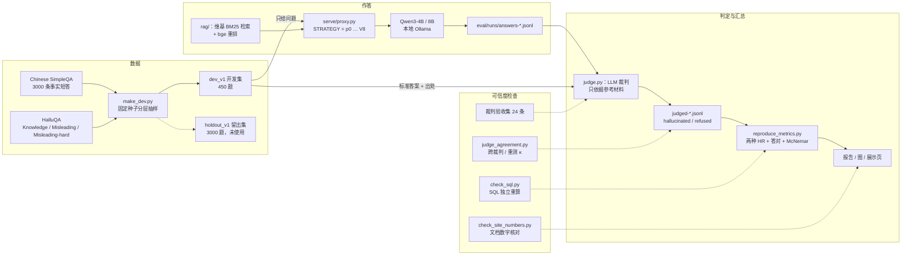
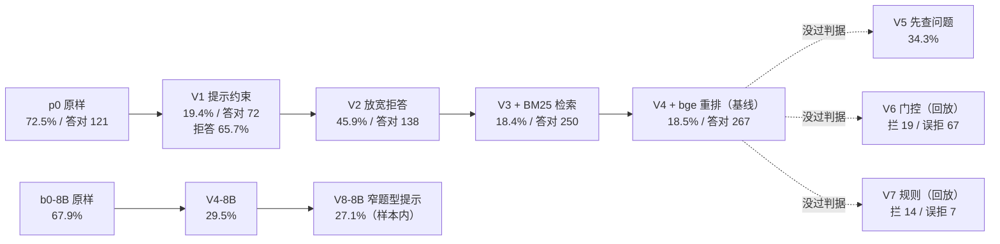

# 面试讲解稿：中文大模型幻觉评测项目

> 用法：三个时长的口述稿，按面试官给的时间挑一版；白板图在最后。**稿子里的每个数字都出自 [report/大模型幻觉评测报告.md](../report/大模型幻觉评测报告.md)**，`python scripts/check_site_numbers.py` 会逐个核对。讲之前最好再跑一遍 `python scripts/reproduce_metrics.py`，对着输出讲。被追问时可以接 [项目深挖40问](项目深挖40问.md)；想举具体错例，翻 [badcase 画廊](../analysis/badcase画廊.md)。
>
> 口径提醒：所有数字都是本地 LLM 裁判给出的代理指标，单裁判、单次采样、开发集上的结果，不是任何官方成绩。说「答对」时心里要清楚，它的意思是「作答且未判幻觉」。

## 一、1 分钟版

> 我做了一个中文大模型幻觉评测。用 Chinese SimpleQA 和 HalluQA 分层抽了 450 题的开发集，用 LLM 当裁判，只依据参考材料判两个标签：有没有幻觉、是不是拒答。然后一版一版地测 Qwen3-4B：提示约束、维基检索、重排、前提核查、门控和规则拦截，每版只改一处，事先写好判据。
>
> 有三个发现。第一，只看一个幻觉率会被骗：光改提示词，幻觉率从 72.5% 降到 19.4%，可那是靠 65.7% 的题直接拒答换来的，答对数反而从 121 掉到 72。所以我始终同时报两种口径的幻觉率和答对数。第二，检索是唯一同时显著减少幻觉、增加答对的一步，配对检验 p<0.001。第三，误导题是短板，我试了三种办法，都没过事先定的判据，失败原因我都写进了报告。
>
> 报告里的数字都能用一条命令从落盘的判定重算，也用 SQL 独立复现过一遍。

（正常语速约 1 分钟。时间不够就只讲「第一个发现」，那是这个项目最值钱的一句话。）

## 二、3 分钟版

> **背景。** 这个项目起于一个大模型幻觉比赛的练习。官方只给了一个公式：幻觉率 = 幻觉样本 / 有效样本，但没说拒答怎么算。如果拒答不算幻觉，模型全拒答就是 0%。所以我从一开始就定了三个数一起报：拒答算有效的幻觉率、把拒答剔除的幻觉率，还有答对数。
>
> **评测设计。** 评测集用固定种子从两个公开数据集分层抽样：Chinese SimpleQA 300 道事实短答，HalluQA 150 道，里面一半是带错误前提的误导题。另外 3000 题放进留出集，一直没用。裁判是 LLM，只看问题、参考材料和回答，输出「幻觉」「拒答」两个布尔值。正式用之前，先拿 24 条人工标注的样例验收，有结果的全部判对，但我会主动说明：24 条全对，一致率的 95% 下界也只有约 86%。
>
> **结果。** Qwen3-4B 原样作答，幻觉率 72.5%。加系统提示约束，幻觉率降到 19.4%，但拒答率到了 65.7%，答对从 121 掉到 72，这一步只是把幻觉换成了拒答。放宽拒答之后，幻觉又涨回去，说明单靠提示词只能在拒答和幻觉之间挪。加维基 BM25 检索，配对看幻觉 206 → 83、答对 138 → 249，都是 p<0.001。再加 bge 重排，幻觉持平，答对到 267，选为基线。
>
> **误导题。** 我试了三种做法：泛化的「先查问题有没有错」提示，结果正常题也开始挑错，幻觉 82 → 151；让模型自己判断题目有没有陷阱，拦住 19 个幻觉，却误拒了 67 道答对的题；写关键词规则，拦 14 个、误拒 7 个。三个都没过门槛，我就停了，没有在开发集上硬调。换到 Qwen3-8B 后，两条很窄的题型提示让误导题明显变好，但那些问法是从同一开发集的错例里归纳的，属于样本内结果。
>
> **可信度。** 我自己做了一轮审稿：14 个配对检验做 Holm 校正后，重排带来的答对增加从 p=0.018 变成 0.092，不再显著，我就改口叫「倾向」。裁判一致性也用已有记录补算了：跨裁判 κ 0.78，agnes 自己重判一次 κ 只有 0.68。还有一点是检索收益偏乐观：SimpleQA 300 题里有 258 题的出处本身就是维基。
>
> **下一步**是先在留出集上确认基线，再做两人独立的人工标注，测裁判和人的一致性。

（正常语速 3 分钟出头。要压时间就删「可信度」里的检索那句。）

## 三、8 分钟版

> 分六段，括号里是建议时长。每段结尾都留了一个「钩子」，面试官多半会顺着它追问。

### 第一段：问题从哪来（约 1 分钟）

> 我想先讲清楚这个项目要回答什么问题。起因是一个大模型幻觉比赛，官方的指标只有一个：幻觉率 = 幻觉样本数 / 有效样本数。我第一反应是这个公式有个漏洞——没说拒答怎么算。如果拒答算「没幻觉」，那模型全拒答就能拿 0%。
>
> 所以这个项目真正想回答的是：在一个固定的小模型上，提示、检索、拦截这几类常见手段，各自能把幻觉降多少、代价是什么。为了不被拒答骗，我从第一天就定下三个数一起报：拒答算有效的 HR、拒答剔除的 HR、答对数。**比例看风险，绝对数看能力。**
>
> （钩子：「那你怎么定义幻觉？」）

### 第二段：评测怎么搭（约 1.5 分钟）

> **数据。** `eval/make_dev.py` 用固定种子分层抽样：Chinese SimpleQA 300 题，6 个一级类各 50；HalluQA 150 题，分成 Knowledge 60、Misleading 60、Misleading-hard 30。剩下 3000 题做留出集，实验全程没碰。这个配比是为了让误导题够测、又不让它主导总分，代价是「全部」那一栏的幻觉率是人为配比下的加权数，所以我更看分题型的数字。
>
> **裁判。** 模型只看到问题；标准答案和出处只交给裁判。裁判提示词要求只依据参考材料判，不用自己的记忆，输出两个布尔值：`hallucinated` 和 `refused`，可以同时为真，比如拒答的同时编了个理由。
>
> **验收。** 上裁判前先用 24 条人工标注的样例验收，六类各 4 条：正确回答、事实错误、捏造引用、错误前提纠正、证据不足、拒答夹带编造。正式用的两个裁判，有结果的条目全部判对。但 24 条太少，一致率的 95% Wilson 下界只有约 86%。
>
> **实验纪律。** 每版只改一处，先写假设和通过判据，再跑；没过就停，不在开发集上反复调到它过。相邻版本用精确 McNemar 配对检验。
>
> （钩子：「24 条全对还不够吗？」）

### 第三段：逐版结果（约 2 分钟）

> 对着白板上的版本图讲（见下文图 2）。
>
> - **p0 原样作答**：Qwen3-4B 幻觉率 72.5%，答对 121。它几乎不拒答，回答长，错误多出在正确答案旁边夹带的年份、人名里。
> - **V1 系统提示约束**：幻觉率 19.4%，看着降了一大截。但拒答率从 2.7% 到 65.7%，答对 121 → 72。配对看，225 道 p0 的幻觉题变成了拒答，同时 61 道本来答对的题也变成了拒答。**这一版的好坏完全取决于拒答怎么计分。**
> - **V2 放宽拒答**：答对回到 138，可幻觉也涨到 206。4B 的参数知识不够，「有印象」的题里错的比对的多。
> - **V3 维基 BM25 检索**：幻觉 206 → 83，答对 138 → 249，都是 p<0.001，是整个实验收益最大的一步。前 5 段命中标准答案的题答对率 85.4%，没命中的只有 35.8%。
> - **V4 加 bge 重排**：检索前 1 段命中率 54.0% → 64.0%；作答上幻觉持平，配对 38 题变好、38 题变坏，答对 248 → 267。选它当基线：幻觉率 18.5%，答对 267，是 p0 的 2.2 倍。
>
> （钩子：「重排的答对增加显著吗？」——答：原始 p=0.018，校正后 0.092，只算倾向。）

### 第四段：误导题，以及三次失败（约 1.5 分钟）

> 误导题是短板：两类误导题按拒答剔除口径，所有 4B 版本都在 52% 以上。错误的典型形态是**顺着前提答**，比如问「所有中国人元宵节都吃什么」，资料里正好有元宵、汤圆，模型就答「都吃元宵或汤圆」（hqa-31）。
>
> 我试了三种办法：
>
> 1. **V5「先查问题有没有错」**：判据是幻觉少于 83、SimpleQA 不超过 11.0%。结果幻觉 151、SimpleQA 26.8%，两条都没过。新增幻觉主要在正常题上，SimpleQA 只 V4 幻觉 6、只 V5 幻觉 56。比如 sqa-0062 本来答对「陶侃」，V5 先说「问题本身有误」，再编了个西晋。**泛化的挑错指令会传染到正常题。**
> 2. **V6 模型自判门控**：SimpleQA 本该几乎不触发，却触发了 73/300；拦住 19 个幻觉，误拒 67 道答对题。关键证据是 SimpleQA 触发题里 V4 的幻觉率 9.6%，和整体的 10.0% 几乎一样——门控没有区分力。同一个模型既答不对又判不准，拆成两步不会凭空多出判别能力。
> 3. **V7 关键词规则**：拦 14 个、误拒 7 个，区分力好得多，但「星座」会误伤天文题（sqa-2054），而且规则是看过开发集错例才写的，有过拟合风险。
>
> 共同的教训：**任何拦截都要同时报拦住多少幻觉、误拒多少答对。** V6 回放后幻觉率 14.3%，是表里最低，但那是多拒答 83 题换来的。
>
> 换到 Qwen3-8B（裁判不同，不能和 4B 横比）：V4 同配置 29.5%，加两条很窄的题型提示（V8）到 27.1%，误导题配对 10 题修好、0 题变坏，p=0.002。但提示点名的问法和我从同一开发集错例里归纳的是同一批，样本内结果，必须上留出集确认。
>
> （钩子：「那你怎么决定什么时候停？」）

### 第五段：这些数字有多可信（约 1.5 分钟）

> 我花时间最多的其实是这一段：证明结论站得住。
>
> - **裁判和规则交叉核对**：SimpleQA 上「标准答案是不是回答的子串」是完全独立的粗评分。V4 里规则命中、裁判却判幻觉的只有 5/187；抽查分歧，大体可信，但有双向噪声，差距小于约 10 题的结论都不可靠。
> - **裁判自己就不稳**：用裁判输入的哈希从已有记录里找重叠样本，零新增调用。跨裁判 188 条 κ 0.78；agnes 自己重判 423 对，κ 只有 0.68。V3→V4 幻觉不一致的 76 题里，有 13 题回答一字未改，只是裁判换了判法。
> - **「资料未提及」伪影**：模型说「参考资料未提及」，指的是自己检索的段落，裁判却当成「声称来源没写」判幻觉。改记为拒答后 V5 的幻觉 151 → 125，结论不变。
> - **多重比较**：全文 14 个配对检验，Holm 校正后，p0→V1、V2→V3、V4→V5 等仍然 p<0.001；重排的答对增加和 V8 的幻觉减少不再显著，我就降级成「倾向」。
> - **检索偏乐观**：SimpleQA 300 题里 258 题的出处是维基，出处不是维基的 42 题，前 5 段命中率只有 42.9%。
>
> （钩子：「κ 为什么比一致率低这么多？」）

### 第六段：下一步与收获（约 0.5 分钟）

> 下一步按优先级：先在 3000 题留出集上跑一次 V4 和 V8，只预先指定一个主对比；再从两个基线版本抽 300 条，两人独立标注，先算人和人的 κ，再算裁判和人工金标准的 κ；关键版本重复采样估计方差。
>
> 这个项目教会我的是：评测的核心不是把某个数字做低，而是**证明一个结论站得住**——口径能不能被钻空子、裁判可不可靠、差异是不是噪声。

（全文 8 分钟左右。现场可以边讲边画下面的图。）

## 四、白板图

### 图 1　评测流水线（建议先画这张）

画法：从左到右三列——**数据**、**作答**、**判定与汇总**；最右边单独画一个「可信度检查」框，用虚线连到判定。讲的时候按箭头顺序走一遍，重点圈出两处：「标准答案只给裁判、不给模型」，以及「数字全部由脚本从落盘结果重算」。

### 图 2　版本演进（讲第三、四段时画）

画法：横向一条主线 p0 → V4，每个节点下面写「幻觉率 / 答对」；V5、V6、V7 从 V4 分叉出去，画成虚线并打叉（没过判据）；8B 另起一行，并在两行之间写明「裁判不同，不可横比」。

### 白板上最容易被追问的三个点

1. **为什么三个数一起报**：在图 2 的 V1 节点旁边写「19.4%，但拒答 65.7%」，一句话讲完口径问题。
2. **裁判看到什么、模型看到什么**：在图 1 里把「只给问题」「标准答案 + 出处」两条箭头描粗。
3. **哪些结论是样本内的**：在图 2 的 V8 节点旁边写「样本内」，主动说出来比被问出来好。
