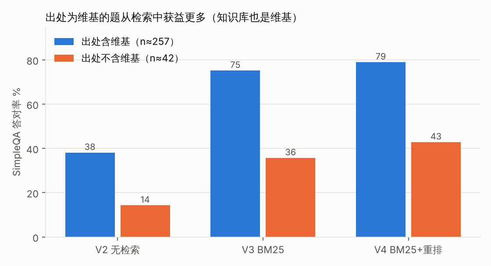
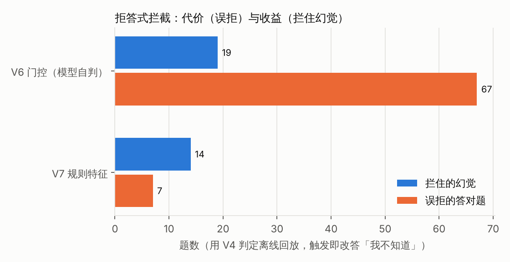

<!-- _class: lead -->
<!-- _paginate: false -->

# Chinese LLM Hallucination Evaluation

### Prompt constraints, retrieval and abstention gates on Qwen3-4B / 8B

450-item Chinese dev set · LLM judge · version-by-version ablation · one-command recomputation

<small>Proxy metrics from a local LLM judge: single judge, single sample, dev set — not an official score</small>

<!--
Opening line: this is a hallucination evaluation, and the point is not a low number but a conclusion that survives.
Every number on these slides comes from report/大模型幻觉评测报告.md or analysis/稳健性分析.md and is checked by scripts/check_site_numbers.py.
Export: npx @marp-team/marp-cli slides/project-talk.en.md --pdf --allow-local-files
-->

---

## The problem: the metric has a loophole

**HR = hallucinated / valid samples**, with no rule for refusals → refuse everything and score 0%

So three numbers are always reported together:

| Metric | Definition | Guards against |
|---|---|---|
| HR (all) | hallucinated / judged | — rewards over-refusal |
| HR (answered) | hallucinated among non-refused / non-refused | "accurate when it answers"; selection effect |
| **Correct** | neither hallucinated nor refused | buying a low HR with refusals |

> "Correct" = answered and not judged hallucinated; the judge never grades correctness on its own.

<!--
V1 is the counter-example: HR 19.4%, but 65.7% refused and correct fell 121 → 72.
-->

---

## Setup

- **Data**: Chinese SimpleQA 300 + HalluQA 150 (Knowledge 60 / Misleading 60 / Misleading-hard 30), fixed-seed stratified sample; 3000 more held out and never used
- **Answering**: the model sees only the question; `serve/proxy.py` switches strategy per version, local Ollama
- **Judge**: sees the reference (gold answer + source) and returns `hallucinated` / `refused`
- **Validation**: 24 hand-labelled cases, all correct — but the 95% lower bound on agreement is only about 86%
- **Discipline**: one change per version, pass criteria written first, exact McNemar on adjacent versions

<!--
If asked "isn't 24 of 24 enough?": the Wilson lower bound for 24/24 is 86.2%, so a 14% error rate is still consistent with it.
-->

---

## Results (Qwen3-4B, judge agnes-2.5-flash)

p0 72.5% → V1 19.4% (65.7% refused) → V3 retrieval 18.4% → **V4 rerank 18.5%, 267 correct (baseline)**

<!--
V6's 14.3% is the lowest HR in the table, but only because it refuses 83 more items.
-->

---

## The one step that really worked: retrieval

- V2 → V3, paired: hallucinations **206 → 83**, correct **138 → 249**, both p<0.001
- Items whose top-5 passages contain the answer: 85.4% correct; misses: 35.8% (correlation, not strict causation)
- Reranking (V4): hallucinations flat (38 vs 38), correct +19 (p=0.018, Holm-corrected 0.092 — only a trend)
- **Optimistic**: 258 of the 300 SimpleQA items cite Wikipedia — the knowledge base

---

## The weak spot: misleading questions

| Version | Approach | Result |
|---|---|---|
| V5 | generic "check the question for errors" | paired hallucinations 82 → 151; spreads to ordinary items |
| V6 | self-judging gate (offline replay) | blocks 19 hallucinations, wrongly refuses 67 correct |
| V7 | keyword rules (offline replay) | blocks 14, wrongly refuses 7 |

**Lesson**: every intercept must report hallucinations blocked *and* correct answers lost

---

## Moving to Qwen3-8B (different judge — not comparable with 4B)

- As-is 67.9% → same V4 setup 29.5% → V8 two narrow question-type hints 27.1%
- On Misleading, V8 fixes **10** and breaks **0** (p=0.002); no contamination on SimpleQA
- Total hallucinations 129 → 117 (p=0.036, Holm-corrected 0.143)
- **In-sample**: the hints were distilled from errors on the same dev set

<!--
Say "in-sample" before the interviewer does.
-->

---

## Robustness: which conclusions survive?

14 paired tests × bootstrap, Holm, 7 judge-labelling variants, 9 leave-one-category-out runs, judge-noise simulation

| Verdict | Conclusions |
|---|---|
| **Holds** (9) | prompt constraints, relaxed refusal, retrieval (both metrics each); V5 harm; V4 setup on 8B (both) |
| **Uncertain** (2) | reranking correct gain; V8 hallucination drop |
| **No difference** (3) | reranking on hallucinations; V5 on correct; V8 on correct |

- Reranking: +4.2 points [+0.9, +7.6], but only 2 items short of Holm significance while 12 items flipped with an identical answer
- V8: Holm-corrected p swings from 0.002 to 1.000 depending on how the 12 / 11 missing judgments are filled

<!--
Details in analysis/稳健性分析.md, regenerated by python analysis/robustness.py and compared byte-for-byte by the checker.
-->

---

## How far can the judge be trusted?

- **Rule cross-check** (SimpleQA): for V4, rule hit but judged hallucinated only 5/187; noise runs both ways
- **Agreement** (no new calls): cross-judge 188 items κ 0.78; agnes re-judging itself κ 0.68 over 423 pairs
- **Noise leaks into pairs**: in V3 → V4, 13 of 76 hallucination-discordant items had a word-for-word identical answer
- **Noise model**: retest disagreement implies a 2.9% per-judgment flip rate; retrieval survives 100.0% of simulations, reranking's verdict only 83.2%

---

## Limits and next steps

**Limits**: single judge, single sample, dev set; judge not independently checked on HalluQA; 4B and 8B judges differ; V5 / V7 / V8 designed on the same dev set

**Next**
1. One run of V4 / V8 on the 3000-item held-out set, with a single pre-registered comparison
2. Two annotators label 300 items: inter-annotator κ first, then judge vs human
3. Sample key versions 3 times to measure answer variance

**Reproduce**: `python scripts/reproduce_metrics.py` · `python analysis/robustness.py` · `python -m pytest`

<!--
Closing line: what this project taught me is that evaluation is about proving a conclusion holds.
-->
