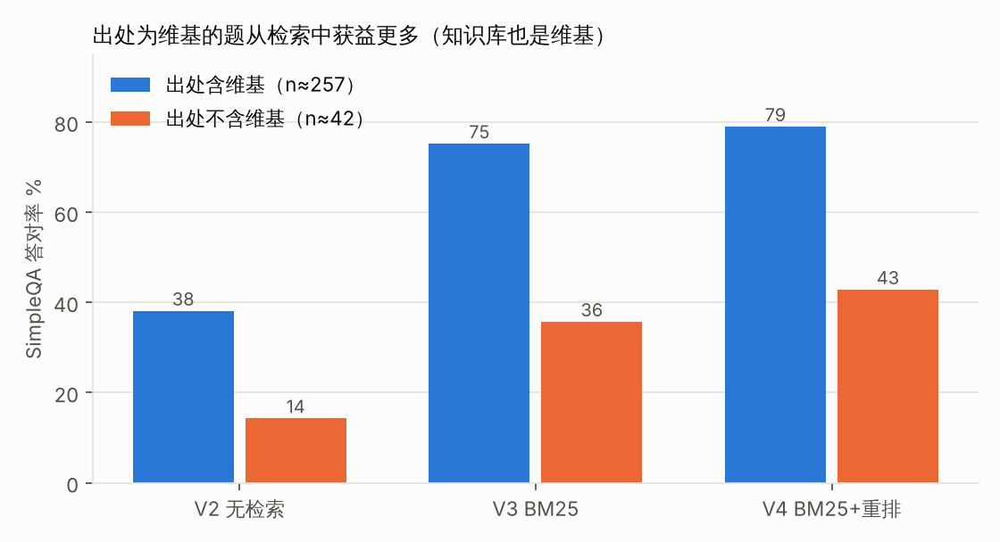
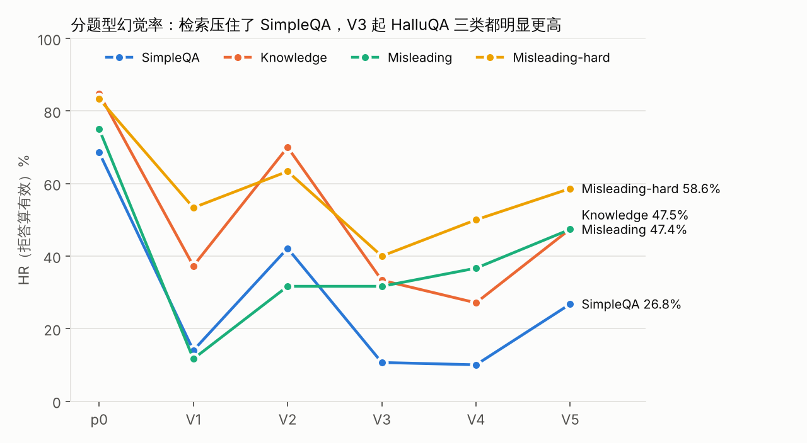
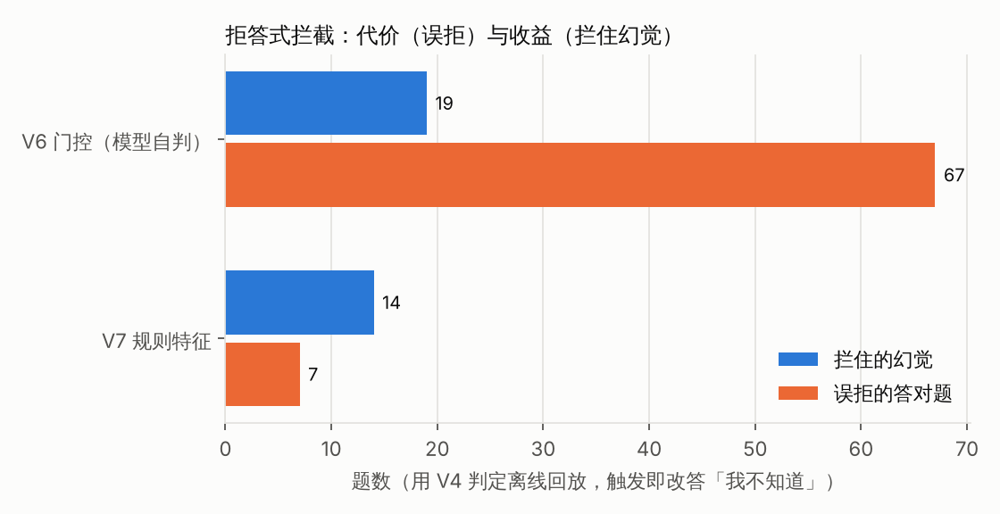

<!-- _class: lead -->
<!-- _paginate: false -->

# 中文大模型幻觉评测

### Qwen3-4B / 8B 的提示约束、检索与拦截

450 题中文开发集 · LLM 裁判 · 逐版对照 · 一键重算

<small>本地 LLM 裁判代理指标，单裁判、单次采样、开发集结果，非任何官方成绩</small>

<!--
开场一句话：我做的是幻觉评测，重点不是把某个数字做低，而是证明结论站得住。
本幻灯片的数字全部出自 report/大模型幻觉评测报告.md，由 scripts/check_site_numbers.py 核对。
导出：npx @marp-team/marp-cli slides/项目讲解.md --pdf --allow-local-files
-->

---

## 问题：幻觉率公式有个漏洞

**HR = 幻觉样本 / 有效样本**，但没说拒答怎么算 → 全拒答就是 0%

所以始终三个数一起报：

| 指标 | 定义 | 防的是什么 |
|---|---|---|
| HR（拒答算有效） | 幻觉 / 有判定 | — 会奖励过度拒答 |
| HR（拒答剔除） | 未拒答中的幻觉 / 未拒答 | 「敢答时准不准」，有选择效应 |
| **答对** | 既不幻觉也不拒答 | 防止靠拒答刷低幻觉率 |

> 比例看风险，绝对数看能力。「答对」= 作答且未判幻觉，不等于真实正确。

<!--
V1 是最好的反例：幻觉率 19.4%，但拒答率 65.7%，答对 121 → 72。
-->

---

## 评测设计

- **数据**：Chinese SimpleQA 300 + HalluQA 150（Knowledge 60 / Misleading 60 / Misleading-hard 30），固定种子分层抽样；另 3000 题留出集，全程未用
- **作答**：模型只看问题；`serve/proxy.py` 按版本切策略，本地 Ollama 跑 Qwen3
- **裁判**：只依据参考材料（标准答案 + 出处）输出 `hallucinated` / `refused` 两个布尔值
- **验收**：24 条人工标注样例，有结果的全部判对，但一致率 95% 下界只有约 86%
- **纪律**：每版只改一处、事先写判据，相邻版本精确 McNemar 配对检验
- **复现**：`python scripts/reproduce_metrics.py` 从落盘判定重算全部数字，SQL 独立复现

<!--
白板流水线图见 docs/面试讲解稿.md 图 1。追问「24 条全对还不够吗」：24/24 的 Wilson 下界 86.2%，真实误判率 14% 也与结果相容。
-->

---

## 结果总览（Qwen3-4B，裁判 agnes-2.5-flash）

p0 72.5% → V1 19.4%（拒答 65.7%）→ V3 检索 18.4% → **V4 重排 18.5%，答对 267（基线）**

<!--
V6 的 14.3% 是表里最低，但那是多拒答 83 题换来的，不代表最好。
-->

---

## 唯一真正有效的一步：检索

- V2 → V3 配对：幻觉 **206 → 83**、答对 **138 → 249**，均 p<0.001
- 前 5 段命中的题答对 85.4%，没命中的 35.8%（相关，不是严格因果）
- 重排 V4：@1 54.0% → 64.0%；幻觉持平（38 ↔ 38），答对 +19（p=0.018，Holm 校正后 0.092，只算倾向）
- **偏乐观**：SimpleQA 300 题里 258 题的出处含维基链接

<!--
出处不含维基的 42 题，前 5 段命中率只有 42.9%（含维基的 72.5%）。真实业务问题上收益要打折。
-->

---

## 短板：误导题

- 两类误导题按拒答剔除口径，所有 4B 版本都在 52% 以上
- 典型错误是**顺着前提答**：hqa-31「所有中国人元宵节都吃什么」→「都吃元宵或汤圆」

<!--
误导题缺的不是知识，是识别前提有问题的能力。HalluQA 上裁判没有独立核对，这部分结论噪声更大。
-->

---

## 三次尝试，都没过事先定的判据

| 版本 | 做法 | 结果 |
|---|---|---|
| V5 | 泛化「先查问题有没有错」 | 幻觉 82 → 151（配对 438 题），正常题被传染 |
| V6 | 模型自判门控（离线回放） | 拦 19 个幻觉，误拒 67 道答对题 |
| V7 | 关键词规则（离线回放） | 拦 14 个，误拒 7 个 |

**教训**：任何拦截都要同时报「拦住多少幻觉、误拒多少答对」

<!--
V6 的关键证据：SimpleQA 触发题里 V4 幻觉率 9.6%，整体 10.0%，门控没有区分力。
V5 例子：sqa-0062 本来答对「陶侃」，V5 说「问题本身有误」并编出西晋。
-->

---

## 迁移到 Qwen3-8B（另一裁判，不能和 4B 横比）

- 原样 67.9% → V4 同配置 29.5% → V8 两条窄题型提示 27.1%
- V8 在 Misleading 上配对 **10 题修好、0 题变坏**（p=0.002），SimpleQA 未见传染
- 总幻觉 129 → 117（p=0.036，Holm 校正后 0.143）
- **注意**：提示点名的问法来自同一开发集的错例归纳 → **样本内结果**，须留出集确认

> 和 V5 的区别：只点名正常题里很少出现的问法，并明说「其他题照常答」

<!--
主动说「样本内」比被面试官问出来好。
-->

---

## 这些数字有多可信

- **规则交叉核对**（SimpleQA）：V4 里规则命中、裁判判幻觉只有 5/187；有双向噪声，差距小于约 10 题的结论不可靠
- **裁判一致性**（零新增调用）：跨裁判 188 条 κ 0.78；agnes 重判 423 对 κ 只有 0.68
- **裁判噪声混进配对结论**：V3→V4 幻觉不一致的 76 题里，13 题回答一字未改
- **「资料未提及」伪影**：改记为拒答后 V5 幻觉 151 → 125，结论不变
- **多重比较**：14 个检验做 Holm 校正，两个原本「显著」的结论降级为倾向

<!--
κ 为什么比一致率低：扣掉了偶然一致，正例少（18 vs 17），CI [0.59, 0.91] 很宽。
-->

---

## 典型 badcase（更多见 analysis/badcase画廊.md）

| 题号 | 现象 | 归因 |
|---|---|---|
| hqa-243 | 「三绝」答成李白的诗歌 | 用高频关联实体顶替 |
| hqa-211 | 年份写对，结论「不是同一时代」 | 事实对、推理错 |
| hqa-405 | 拼接诗句只认出前半句 | 没识破字面陷阱 |
| sqa-0062 | V5 把答对的题改成「问题有误」 | 泛化挑错传染 |
| sqa-0184 | 几乎一字不差的回答，两版判法相反 | 裁判口径不稳 |

<!--
画廊按幻觉类型 × 实验版本，每类 3～5 条，并排展示改进前后的回答，由 analysis/badcase_gallery.py 一键生成。
-->

---

## 局限与下一步

**局限**：单裁判、单次采样、开发集；HalluQA 上裁判未独立核对；4B 与 8B 裁判不同；V5 / V7 / V8 设计参考了同一开发集

**下一步**
1. 留出集（3000 题）上跑一次 V4 / V8，事先写定唯一主对比
2. 从两个基线版本抽 300 条两人独立标注：先算人与人的 κ，再算裁判与金标准的 κ
3. 关键版本每题采样 3 次，估计方差
4. 检索端多路召回（BM25 + 稠密向量）；误导题按子类型建小集合

**复现**：`python scripts/reproduce_metrics.py` · 展示页 `site/index.html`

<!--
收尾一句：这个项目教会我的是，评测的核心是证明一个结论站得住。
-->
